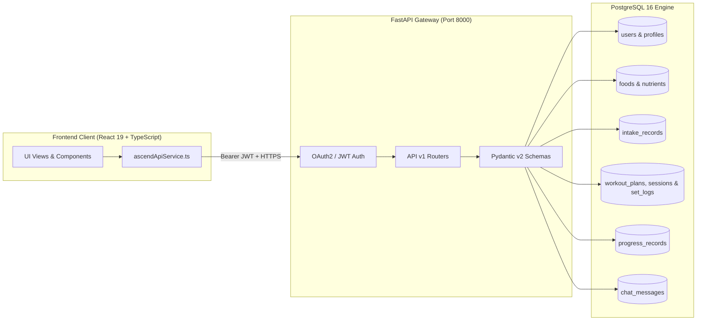

# ASCEND — Backend Handoff Specification (FastAPI + PostgreSQL)

**Document Version:** 1.1.0
**Target Architecture:** FastAPI (Python 3.12+) & PostgreSQL 16+ (SQLAlchemy 2.0 / Alembic / Pydantic v2)
**Author:** ASCEND Engineering & Frontend Architecture Team
**Scope:** Complete contract specification, relational schema, API endpoints, authentication flows, and data provenance rules for migrating from frontend prototype state to production backend services.

---

## 1. Executive Summary & Architectural Overview

The ASCEND frontend platform has completed its Phase 2 verified fixes, visual design system, and multi-pathway client-side state architecture. Currently, state is managed in `src/App.tsx` and persisted via browser storage (`prototypeSessionStorage`).

This document defines the strict specification for building the accompanying production backend using **FastAPI** and **PostgreSQL**, applying relational database management system (RDBMS) best practices:
- Third Normal Form (3NF) relational models.
- Foreign key integrity, unique constraints, and check constraints across all entities.
- Optimized indexing for time-series biometrics, food catalog searching, and workout logging.
- ACID transaction guarantees for meal logging and workout session completions.



---

## 2. Relational Database Architecture (PostgreSQL Schema)

### Entity-Relationship Diagram (ERD)

```mermaid
erDiagram
    USERS ||--|| USER_PROFILES : has
    USERS ||--|| NUTRITION_GOALS : defines
    USERS ||--o{ INTAKE_RECORDS : logs
    USERS ||--o{ WORKOUT_SESSIONS : executes
    USERS ||--o{ PROGRESS_RECORDS : tracks
    USERS ||--o{ CHAT_MESSAGES : sends
    FOOD_ITEMS ||--o{ INTAKE_RECORDS : referenced_by
    FOOD_ITEMS ||--|| NUTRIENT_VALUES : has
    WORKOUT_PLANS ||--o{ EXERCISE_ITEMS : contains
    WORKOUT_PLANS ||--o{ WORKOUT_SESSIONS : instantiates
    WORKOUT_SESSIONS ||--o{ EXERCISE_SET_LOGS : records

    USERS {
        uuid id PK
        varchar email UK
        varchar password_hash
        varchar full_name
        boolean is_active
        boolean is_demo_account
        timestamp created_at
        timestamp updated_at
    }

    USER_PROFILES {
        uuid id PK
        uuid user_id FK, UK
        varchar pathway
        varchar archetype
        varchar goal_type
        varchar biological_sex
        varchar unit_system
        numeric current_weight_kg
        numeric target_weight_kg
        numeric height_cm
        integer age
        varchar activity_level
        integer training_days_per_week
        timestamp updated_at
    }

    NUTRITION_GOALS {
        uuid id PK
        uuid user_id FK, UK
        integer daily_calories
        numeric protein_g
        numeric carbs_g
        numeric fat_g
        integer water_ml
        integer daily_steps
        integer weekly_workout_sessions
        integer weekly_activity_minutes
        timestamp updated_at
    }

    FOOD_ITEMS {
        uuid id PK
        varchar code UK
        varchar name
        varchar alternate_names
        varchar category
        varchar cuisine_region
        varchar preparation_state
        numeric reference_quantity
        varchar reference_unit
        varchar reference_label
        numeric grams_per_serving
        varchar brand_or_source
        varchar license_type
        boolean is_micronutrient_complete
        text data_note
        timestamp created_at
    }

    NUTRIENT_VALUES {
        uuid id PK
        uuid food_id FK, UK
        numeric calories
        numeric protein_g
        numeric carbs_g
        numeric fat_g
        numeric fiber_g NULL
        numeric sugar_g NULL
        numeric sodium_mg NULL
        numeric potassium_mg NULL
        numeric calcium_mg NULL
        numeric iron_mg NULL
    }

    INTAKE_RECORDS {
        uuid id PK
        uuid user_id FK
        uuid food_id FK
        varchar meal
        date date_logged
        varchar time_logged
        numeric quantity
        varchar unit
        integer computed_calories
        numeric computed_protein_g
        numeric computed_carbs_g
        numeric computed_fat_g
        boolean is_user_logged
        timestamp created_at
    }

    WORKOUT_PLANS {
        uuid id PK
        varchar title
        varchar day_label
        varchar focus_area
        integer estimated_minutes
        varchar intensity_label
        integer target_calories_burned
        varchar recommended_pathway
        timestamp created_at
    }

    EXERCISE_ITEMS {
        uuid id PK
        uuid workout_plan_id FK
        varchar name
        varchar muscle_group
        integer default_sets
        varchar default_reps
        numeric default_load_kg
        integer rest_seconds
        text notes
        integer sort_order
    }

    WORKOUT_SESSIONS {
        uuid id PK
        uuid user_id FK
        uuid workout_plan_id FK
        varchar session_title
        date date_logged
        integer duration_minutes
        integer rpe
        boolean completed
        timestamp created_at
    }

    EXERCISE_SET_LOGS {
        uuid id PK
        uuid workout_session_id FK
        varchar exercise_name
        varchar muscle_group
        integer set_number
        varchar target_reps
        numeric target_load_kg
        integer actual_reps
        numeric actual_load_kg
        boolean completed
        timestamp created_at
    }

    PROGRESS_RECORDS {
        uuid id PK
        uuid user_id FK
        date date_recorded
        varchar label
        numeric weight_kg
        numeric body_fat_pct NULL
        numeric lean_mass_kg NULL
        numeric waist_cm NULL
        numeric chest_cm NULL
        numeric arm_cm NULL
        numeric thigh_cm NULL
        integer calories_consumed
        numeric protein_consumed_g
        boolean workout_completed
        integer activity_minutes
        integer steps_count
        varchar source
        timestamp created_at
    }

    CHAT_MESSAGES {
        uuid id PK
        uuid user_id FK
        varchar role
        text content
        jsonb structured_insight NULL
        timestamp created_at
    }
```

### Table DDL & Relational Constraints

```sql
-- 1. Users Table
CREATE TABLE users (
    id UUID PRIMARY KEY DEFAULT gen_random_uuid(),
    email VARCHAR(255) UNIQUE NOT NULL,
    password_hash VARCHAR(255) NOT NULL,
    full_name VARCHAR(150) NOT NULL,
    is_active BOOLEAN NOT NULL DEFAULT TRUE,
    is_demo_account BOOLEAN NOT NULL DEFAULT FALSE,
    created_at TIMESTAMPTZ NOT NULL DEFAULT NOW(),
    updated_at TIMESTAMPTZ NOT NULL DEFAULT NOW()
);

-- 2. User Profiles Table
CREATE TABLE user_profiles (
    id UUID PRIMARY KEY DEFAULT gen_random_uuid(),
    user_id UUID NOT NULL REFERENCES users(id) ON DELETE CASCADE,
    pathway VARCHAR(50) NOT NULL CHECK (pathway IN ('General Nutrition & Diet', 'Athlete Performance', 'Weight Gain & Muscle Gain')),
    archetype VARCHAR(50) NOT NULL,
    goal_type VARCHAR(50) NOT NULL,
    biological_sex VARCHAR(20) NOT NULL DEFAULT 'unspecified' CHECK (biological_sex IN ('male', 'female', 'unspecified')),
    unit_system VARCHAR(30) NOT NULL DEFAULT 'Metric (kg, cm, ml)',
    current_weight_kg NUMERIC(5,2) NOT NULL CHECK (current_weight_kg > 0),
    target_weight_kg NUMERIC(5,2) NOT NULL CHECK (target_weight_kg > 0),
    height_cm NUMERIC(5,2) NOT NULL CHECK (height_cm > 0),
    age INT NOT NULL CHECK (age >= 12 AND age <= 120),
    activity_level VARCHAR(50) NOT NULL,
    training_days_per_week INT NOT NULL CHECK (training_days_per_week BETWEEN 0 AND 7),
    updated_at TIMESTAMPTZ NOT NULL DEFAULT NOW(),
    CONSTRAINT uq_user_profiles_user UNIQUE (user_id)
);

-- 3. Nutrition Goals Table
CREATE TABLE nutrition_goals (
    id UUID PRIMARY KEY DEFAULT gen_random_uuid(),
    user_id UUID NOT NULL REFERENCES users(id) ON DELETE CASCADE,
    daily_calories INT NOT NULL CHECK (daily_calories > 500 AND daily_calories < 10000),
    protein_g NUMERIC(5,1) NOT NULL CHECK (protein_g >= 0),
    carbs_g NUMERIC(5,1) NOT NULL CHECK (carbs_g >= 0),
    fat_g NUMERIC(5,1) NOT NULL CHECK (fat_g >= 0),
    water_ml INT NOT NULL CHECK (water_ml >= 0),
    daily_steps INT NOT NULL DEFAULT 10000,
    weekly_workout_sessions INT NOT NULL DEFAULT 4,
    weekly_activity_minutes INT NOT NULL DEFAULT 200,
    updated_at TIMESTAMPTZ NOT NULL DEFAULT NOW(),
    CONSTRAINT uq_nutrition_goals_user UNIQUE (user_id)
);

-- 4. Food Catalogue & Nutrient Values (Strict nullability for unmeasured micronutrients)
CREATE TABLE food_items (
    id UUID PRIMARY KEY DEFAULT gen_random_uuid(),
    code VARCHAR(50) UNIQUE NOT NULL,
    name VARCHAR(200) NOT NULL,
    alternate_names TEXT[],
    category VARCHAR(100) NOT NULL,
    cuisine_region VARCHAR(50),
    preparation_state VARCHAR(50) NOT NULL CHECK (preparation_state IN ('raw', 'cooked', 'composite_dish', 'packaged')),
    reference_quantity NUMERIC(6,2) NOT NULL DEFAULT 100,
    reference_unit VARCHAR(20) NOT NULL DEFAULT 'g',
    reference_label VARCHAR(100) NOT NULL,
    grams_per_serving NUMERIC(6,2) NOT NULL,
    brand_or_source VARCHAR(150) NOT NULL,
    license_type VARCHAR(50) NOT NULL,
    is_micronutrient_complete BOOLEAN NOT NULL DEFAULT FALSE,
    data_note TEXT,
    created_at TIMESTAMPTZ NOT NULL DEFAULT NOW()
);

CREATE TABLE nutrient_values (
    id UUID PRIMARY KEY DEFAULT gen_random_uuid(),
    food_id UUID NOT NULL REFERENCES food_items(id) ON DELETE CASCADE,
    calories NUMERIC(6,1) NOT NULL,
    protein_g NUMERIC(5,2) NOT NULL,
    carbs_g NUMERIC(5,2) NOT NULL,
    fat_g NUMERIC(5,2) NOT NULL,
    fiber_g NUMERIC(5,2) NULL, -- Strictly nullable (never store unmeasured as 0)
    sugar_g NUMERIC(5,2) NULL, -- Strictly nullable
    sodium_mg NUMERIC(6,1) NULL, -- Strictly nullable
    potassium_mg NUMERIC(6,1) NULL, -- Strictly nullable
    calcium_mg NUMERIC(6,1) NULL, -- Strictly nullable
    iron_mg NUMERIC(5,2) NULL, -- Strictly nullable
    CONSTRAINT uq_nutrient_values_food UNIQUE (food_id)
);

-- 5. Daily Meal Intake Ledger
CREATE TABLE intake_records (
    id UUID PRIMARY KEY DEFAULT gen_random_uuid(),
    user_id UUID NOT NULL REFERENCES users(id) ON DELETE CASCADE,
    food_id UUID NOT NULL REFERENCES food_items(id) ON DELETE RESTRICT,
    meal VARCHAR(20) NOT NULL CHECK (meal IN ('Breakfast', 'Lunch', 'Snacks', 'Dinner')),
    date_logged DATE NOT NULL,
    time_logged VARCHAR(10) NOT NULL,
    quantity NUMERIC(6,2) NOT NULL CHECK (quantity > 0),
    unit VARCHAR(20) NOT NULL CHECK (unit IN ('g', 'oz', 'serving', 'ml', 'cup')),
    computed_calories INT NOT NULL,
    computed_protein_g NUMERIC(5,1) NOT NULL,
    computed_carbs_g NUMERIC(5,1) NOT NULL,
    computed_fat_g NUMERIC(5,1) NOT NULL,
    is_user_logged BOOLEAN NOT NULL DEFAULT TRUE,
    created_at TIMESTAMPTZ NOT NULL DEFAULT NOW()
);

-- 6. Workout Template Plans & Exercises
CREATE TABLE workout_plans (
    id UUID PRIMARY KEY DEFAULT gen_random_uuid(),
    title VARCHAR(150) NOT NULL,
    day_label VARCHAR(50) NOT NULL,
    focus_area VARCHAR(100) NOT NULL,
    estimated_minutes INT NOT NULL,
    intensity_label VARCHAR(50) NOT NULL CHECK (intensity_label IN ('Low', 'Moderate', 'High', 'Peak Performance')),
    target_calories_burned INT NOT NULL,
    recommended_pathway VARCHAR(50) NULL CHECK (recommended_pathway IN ('General Nutrition & Diet', 'Athlete Performance', 'Weight Gain & Muscle Gain')),
    created_at TIMESTAMPTZ NOT NULL DEFAULT NOW()
);

CREATE TABLE exercise_items (
    id UUID PRIMARY KEY DEFAULT gen_random_uuid(),
    workout_plan_id UUID NOT NULL REFERENCES workout_plans(id) ON DELETE CASCADE,
    name VARCHAR(150) NOT NULL,
    muscle_group VARCHAR(100) NOT NULL,
    default_sets INT NOT NULL CHECK (default_sets > 0),
    default_reps VARCHAR(50) NOT NULL,
    default_load_kg NUMERIC(5,1) NOT NULL DEFAULT 0,
    rest_seconds INT NOT NULL DEFAULT 90,
    notes TEXT,
    sort_order INT NOT NULL DEFAULT 0
);

-- 7. User Workout Sessions & Granular Set Logs
CREATE TABLE workout_sessions (
    id UUID PRIMARY KEY DEFAULT gen_random_uuid(),
    user_id UUID NOT NULL REFERENCES users(id) ON DELETE CASCADE,
    workout_plan_id UUID REFERENCES workout_plans(id) ON DELETE SET NULL,
    session_title VARCHAR(150) NOT NULL,
    date_logged DATE NOT NULL,
    duration_minutes INT NOT NULL CHECK (duration_minutes >= 0),
    rpe INT CHECK (rpe BETWEEN 1 AND 10),
    completed BOOLEAN NOT NULL DEFAULT FALSE,
    created_at TIMESTAMPTZ NOT NULL DEFAULT NOW()
);

CREATE TABLE exercise_set_logs (
    id UUID PRIMARY KEY DEFAULT gen_random_uuid(),
    workout_session_id UUID NOT NULL REFERENCES workout_sessions(id) ON DELETE CASCADE,
    exercise_name VARCHAR(150) NOT NULL,
    muscle_group VARCHAR(100),
    set_number INT NOT NULL CHECK (set_number > 0),
    target_reps VARCHAR(20) NOT NULL,
    target_load_kg NUMERIC(5,1) NOT NULL DEFAULT 0,
    actual_reps INT NOT NULL CHECK (actual_reps >= 0),
    actual_load_kg NUMERIC(5,1) NOT NULL CHECK (actual_load_kg >= 0),
    completed BOOLEAN NOT NULL DEFAULT FALSE,
    created_at TIMESTAMPTZ NOT NULL DEFAULT NOW()
);

-- 8. Biometric Progress Tracking Time-Series
CREATE TABLE progress_records (
    id UUID PRIMARY KEY DEFAULT gen_random_uuid(),
    user_id UUID NOT NULL REFERENCES users(id) ON DELETE CASCADE,
    date_recorded DATE NOT NULL,
    label VARCHAR(100),
    weight_kg NUMERIC(5,2) NOT NULL CHECK (weight_kg > 0),
    body_fat_pct NUMERIC(4,1) NULL CHECK (body_fat_pct >= 3 AND body_fat_pct <= 60),
    lean_mass_kg NUMERIC(5,2) NULL,
    waist_cm NUMERIC(5,1) NULL,
    chest_cm NUMERIC(5,1) NULL,
    arm_cm NUMERIC(5,1) NULL,
    thigh_cm NUMERIC(5,1) NULL,
    calories_consumed INT NOT NULL DEFAULT 0,
    protein_consumed_g NUMERIC(5,1) NOT NULL DEFAULT 0,
    workout_completed BOOLEAN NOT NULL DEFAULT FALSE,
    activity_minutes INT NOT NULL DEFAULT 0,
    steps_count INT NOT NULL DEFAULT 0,
    source VARCHAR(20) NOT NULL DEFAULT 'logged' CHECK (source IN ('sample', 'logged')),
    created_at TIMESTAMPTZ NOT NULL DEFAULT NOW(),
    CONSTRAINT uq_progress_user_date UNIQUE (user_id, date_recorded)
);

-- 9. AI Coach Chat History
CREATE TABLE chat_messages (
    id UUID PRIMARY KEY DEFAULT gen_random_uuid(),
    user_id UUID NOT NULL REFERENCES users(id) ON DELETE CASCADE,
    role VARCHAR(20) NOT NULL CHECK (role IN ('user', 'assistant')),
    content TEXT NOT NULL,
    structured_insight JSONB NULL,
    created_at TIMESTAMPTZ NOT NULL DEFAULT NOW()
);

-- Performance Indexes
CREATE INDEX idx_intake_user_date ON intake_records(user_id, date_logged);
CREATE INDEX idx_workout_sessions_user_date ON workout_sessions(user_id, date_logged);
CREATE INDEX idx_exercise_sets_session ON exercise_set_logs(workout_session_id);
CREATE INDEX idx_progress_user_date ON progress_records(user_id, date_recorded);
CREATE INDEX idx_chat_user_created ON chat_messages(user_id, created_at);
CREATE INDEX idx_food_search_name ON food_items USING gin(to_tsvector('english', name));
```

---

## 3. Required API Endpoints (FastAPI Specification)

All endpoints conform to `/api/v1` prefix and return JSON with standard ISO 8601 timestamps.

### A. Authentication & User Profile
- `POST /api/v1/auth/register` — Create user account, hash password via Argon2id, return JWT access token.
- `POST /api/v1/auth/login` — Standard OAuth2 Password Bearer flow; returns `{ access_token, token_type: "bearer" }`.
- `GET /api/v1/users/me` — Return current authenticated user account, active profile, and goals.
- `PUT /api/v1/users/me/profile` — Update physical biometrics, unit system, biological sex, and activity level.
- `PUT /api/v1/users/me/pathway` — Switch focus pathway. **CRITICAL:** Recalculates recommended energy/macro targets while preserving all historical intake records.

### B. Nutrition & Food Catalogue
- `GET /api/v1/foods/search?q={query}&category={category}` — Full-text search across food names, culinary regional aliases, and alternate names.
- `GET /api/v1/foods/{food_id}` — Return complete nutrient values, preparation state, and USDA/ICMR-NIN provenance metadata.
- `POST /api/v1/foods/custom` — Allow users to save private custom food items.

### C. Daily Meal Intake Ledger
- `GET /api/v1/intake?date={YYYY-MM-DD}` — Fetch all logged records for date, including computed daily totals.
- `POST /api/v1/intake` — Log a meal portion. Validates food existence and stores calculated macros.
- `PUT /api/v1/intake/{record_id}` — Update quantity, unit, or meal assignment.
- `DELETE /api/v1/intake/{record_id}` — Remove item from daily ledger (supports undo window on client).
- `GET /api/v1/intake/export/csv?from={date}&to={date}` — Stream CSV export with full provenance columns.

### D. Workouts & Training Management
- `GET /api/v1/workouts/plans?pathway={pathway}` — Fetch recommended workout routine templates for active pathway.
- `POST /api/v1/workouts/sessions` — Record completed workout session including sets, load weights, repetitions, and RPE.
- `GET /api/v1/workouts/history?from={date}&to={date}` — Retrieve historical training sessions and compliance metrics.

### E. Biometrics & Progress Tracking
- `GET /api/v1/analytics/progress` — Fetch time-series bodyweight, body fat, and circumference records.
- `POST /api/v1/analytics/check-in` — Submit weekly weight and body measurements check-in.

### F. Contextual AI Coach
- `POST /api/v1/ai/chat` — Context-aware interactive coaching prompt. Receives prompt string; server extracts recent 7-day intake records and training compliance to generate personalized Gemini guidance.
- `POST /api/v1/ai/recommendations` — Context-aware automated macro and workout pacing recommendations.

---

## 4. Scientific Calculation & Provenance Rules for Backend

1. **Energy Formula (Mifflin-St Jeor)**:
   - **Male**: $\text{BMR} = 10 \times \text{weight (kg)} + 6.25 \times \text{height (cm)} - 5 \times \text{age} + 5$
   - **Female**: $\text{BMR} = 10 \times \text{weight (kg)} + 6.25 \times \text{height (cm)} - 5 \times \text{age} - 161$
   - **Unspecified / Non-binary**: Defaults to $-78\text{ kcal}$ (clinical midpoint constant $\frac{+5 + (-161)}{2} = -78$).
   - $\text{TDEE} = \text{BMR} \times \text{PAL Multiplier}$ (Sedentary: 1.2, Lightly Active: 1.375, Moderately Active: 1.55, Very Active: 1.725, Competitive Athlete: 1.9).
2. **Macronutrient Multipliers**:
   - $\text{Calories} = (\text{Protein}_{\text{g}} \times 4) + (\text{Carbs}_{\text{g}} \times 4) + (\text{Fat}_{\text{g}} \times 9)$
3. **Missing Micronutrient Integrity**:
   - An unmeasured micronutrient must NEVER be saved as `0`. If not reported by FDC or IFCT, store as SQL `NULL`.
4. **Hydration State Distinctions**:
   - Food database queries must return `preparation_state` (`'raw'` vs `'cooked'`) and refuse multipliers.

---

## 5. Security & Deployment Strategy

- **Password Security**: Argon2id via `passlib[argon2]`. Minimum 8 characters.
- **JWT Authorization**: Signed with asymmetric RS256 or HS256 with 7-day expiry and refresh rotation.
- **CORS Configuration**: Restrict allowed origins to frontend production domain and `http://localhost:3000`.
- **Database Migrations**: Managed exclusively through Alembic (`alembic upgrade head`).
- **Connection Pooling**: `asyncpg` with PgBouncer connection pooler (20 min connections, 50 max).
