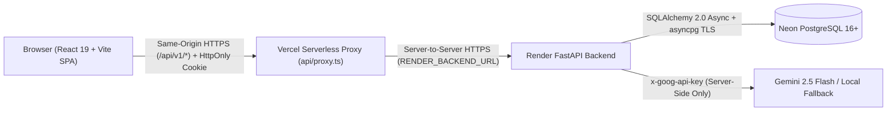

# ASCEND

**AI Nutrition & Fitness Platform** — *"Getting Better Every Day."*


-15803D)


ASCEND is a full-stack nutrition, workout, and biometric tracking platform built to adapt to distinct personal fitness goals. It combines Mifflin-St Jeor energy modeling, Third Normal Form (3NF) food and nutrient storage, per-set workout telemetry, hydration tracking, and goal-aware AI coaching inside one cohesive web application.

Generic calorie trackers often apply a single formula to everyone, overwrite historical meal logs when food definitions change, or expose session tokens in browser `localStorage`. ASCEND solves these problems for everyday users, endurance/performance athletes, and muscle-building lifters through pathway-specific adaptation, immutable meal snapshots, local PostgreSQL food search, and hardened cookie-based session security.

---

## Production Deployment

| Service | URL | Status |
| :--- | :--- | :--- |
| **Frontend** | [ascend-six-iota.vercel.app](https://ascend-six-iota.vercel.app/) | ✅ Live |
| **Backend API** | [ascend-api-3zkt.onrender.com](https://ascend-api-3zkt.onrender.com/api/v1/health) | ✅ Live |
| **Database** | Neon PostgreSQL — production branch | ✅ Connected |

> [!NOTE]
> The Render backend runs on a **free-tier instance** that sleeps after 15 minutes of inactivity. The first request after a cold start may take 30–60 seconds while Render wakes the service. Subsequent requests are fast. The Vercel proxy has a 25-second timeout; a cold start may cause the initial request to time out — simply retry after a few seconds.

---

## Key Features

- **Three Goal Pathways:** Adapts calorie/macro targets, hydration buffers, workout templates, dashboards, and AI coaching across:
  - **General Nutrition & Diet:** Balanced macro distribution, sustainable deficit/maintenance modeling, and daily meal adherence.
  - **Athlete Performance:** Fueling buffer, `2.2 g/kg` protein framing, carbohydrate timing, and `+450 ml` sweat-loss hydration adjustment.
  - **Weight Gain & Muscle Gain:** Controlled lean surplus, `2.1 g/kg` protein targets, and hypertrophy progressive overload tracking.
- **Food Catalogue & Live Search:** PostgreSQL-backed search (`pg_trgm`) across imported USDA FoodData Central items and documented ASCEND Indian recipe estimates, with category filters and raw/cooked/recipe preparation tags.
- **Meal Logging & Portion Customization:** Unit-aware scaling (`g`, `ml`, `oz`, `cup`, `serving`), side-by-side nutrient comparison, user-private custom foods, 6-second Undo support, and immutable nutrient snapshots saved on each meal log.
- **Hydration Tracking:** Quick-add hydration controls (`+250 ml`, `+500 ml`, `+750 ml`, `-250 ml`) persisted in PostgreSQL (`water_intake_records`).
- **Workout Plans & Set-by-Set Telemetry:** Pathway workout templates, custom plans, user-scoped ad-hoc exercises, an interactive rest timer, and per-set reps/load (`kg`) persistence.
- **Progress Tracking & Reports:** Weight, body fat %, and circumference check-ins with Recharts trend curves, 30-day adherence reports, and formula-injection-safe CSV export.
- **Calendar & Goal Management:** Monthly nutrition/workout consistency calendar and live Mifflin-St Jeor BMR/TDEE goal recalculation.
- **AI Coach with Fallback:** Multi-turn coaching powered by Google Gemini 2.5 Flash (server-side key) with automatic deterministic local heuristic fallback when Gemini is unavailable or unconfigured.
- **Authentication & Demo Isolation:** Argon2id password hashing, rotating `HttpOnly` refresh cookies, device session management, password-verified pathway switching, and an isolated offline Demo Mode.

---

## Technology Stack

| Layer | Technologies |
| :--- | :--- |
| **Frontend** | React 19, TypeScript 5, Vite 8, Tailwind CSS 4 (`@tailwindcss/vite`), Lucide React, Recharts |
| **Backend** | Python 3.13, FastAPI, Pydantic v2, SQLAlchemy 2.0 Async, `asyncpg`, Alembic, Argon2id (`argon2-cffi`), PyJWT |
| **Database** | PostgreSQL 16+ (16 application tables + `v_food_items_with_nutrients`, `pg_trgm` extension) |
| **Infrastructure** | Vercel (Frontend + `/api/proxy.ts` same-origin proxy), Render (FastAPI backend), Neon (PostgreSQL) |
| **AI Integration** | Google Gemini Developer API (`gemini-2.5-flash` via `httpx`) + deterministic local heuristic fallback |

### Role of the Vercel Proxy & Server-Side Environment Variables
In production, browser requests target same-origin `/api/v1/...`, which `vercel.json` rewrites to [api/proxy.ts](./api/proxy.ts). The serverless proxy forwards requests server-to-server to `RENDER_BACKEND_URL` (stored strictly server-side on Vercel without a `VITE_` prefix), preserves multi-value `Set-Cookie` headers so `HttpOnly` refresh cookies work first-party without third-party cookie blocking, blocks path traversal/SSRF, and forwards verified client IPs. Secrets (`DATABASE_URL`, `SECRET_KEY`, `GEMINI_API_KEY`) remain strictly on Render.

---

## Architecture



- **Authentication & Session Flow:** Access tokens (30-minute HS256 JWT) live only in JS memory. Refresh tokens (7-day opaque secrets) are stored as `SHA-256` hashes in `user_refresh_sessions` and delivered via `HttpOnly; SameSite=Lax` cookies scoped to `/api/v1/auth` with `X-Requested-With` CSRF protection and token-reuse detection.
- **Local-First Food Catalogue Ingestion:** External nutrition datasets are downloaded and normalized offline via `backend/app/db/ingest/cli.py` into PostgreSQL. Runtime food search queries only ASCEND's PostgreSQL database—never external food APIs.

---

## Database Design

ASCEND uses a **16-table normalized PostgreSQL schema** plus **1 database view** (`v_food_items_with_nutrients`), managed with **Alembic** (current migration head: `e7f8a9b0c1d2`):

- **Identity & Security (`4` tables):** `users`, `user_refresh_sessions`, `user_profiles`, `nutrition_goals`
- **Nutrition — Pure 3NF (`5` tables + `1` view):** `nutrients`, `food_items` (with provenance metadata, check constraints, and partial unique index `uq_food_items_source_identity`), `food_nutrients` (omits unmeasured micronutrients as `null`), `intake_records` (immutable frozen nutrient snapshots), `water_intake_records`, plus `v_food_items_with_nutrients`
- **Workouts (`4` tables):** `workout_plans`, `exercise_items`, `workout_sessions`, `exercise_set_logs`
- **Biometrics (`1` table):** `progress_records`
- **AI Coach (`2` tables):** `chat_conversations`, `chat_messages`

See [docs/DATABASE_AND_API.md](./docs/DATABASE_AND_API.md) and [docs/architecture/ER_DIAGRAM.md](./docs/architecture/ER_DIAGRAM.md) for full schema, constraint, and migration details.

---

## Food Data & Methodology

ASCEND isolates food composition sources and licenses in PostgreSQL and displays attribution in a single **Food Data Sources & Attribution** section on the homepage:

- **USDA FoodData Central (`Public Domain · CC0 1.0`):** Imported locally from official Foundation Foods and SR Legacy archives. **8,172 items live in production PostgreSQL** (364 Foundation + 7,793 SR Legacy + 15 ASCEND recipes).
- **ASCEND Indian Recipe Estimates (`Estimated · Non-Lab`):** `15` independently documented composite Indian dishes calculated from standardized ingredient weights (`backend/app/db/ingest/recipes_indian.json`), explicitly labeled as estimates rather than laboratory reference values.
- **Open Food Facts (`ODbL 1.0 · Pending Import`):** Ingestion adapter (`off_adapter.py`) is implemented and unit-tested; bulk dataset import is pending upstream export availability (upstream returned HTTP 503 during acquisition).
- **ICMR-NIN IFCT 2017 (`Pending Authorization`):** Electronic IFCT tables are not bundled or redistributed without prior written authorization from ICMR-NIN.

See [docs/FOOD_DATA_PROVENANCE_AND_INGESTION.md](./docs/FOOD_DATA_PROVENANCE_AND_INGESTION.md) for details.

---

## Project Structure

```text
Ascend/
├── src/                                  # React 19 + TypeScript frontend
│   ├── components/                       # Landing, Dashboard, Diet, Workouts, Progress, Goals, Coach, Calendar, Reports, Settings
│   ├── services/                         # API clients (src/services/api/*) & nutrition calculators
│   ├── data/                             # Offline Demo Mode baseline dataset
│   ├── types/                            # Shared TypeScript interfaces & enums
│   └── utils/                            # Date & formatting helpers
├── backend/                              # FastAPI + SQLAlchemy 2.0 Async backend
│   ├── app/
│   │   ├── api/v1/                       # Versioned REST endpoints & dependencies
│   │   ├── core/                         # Config, database pool, rate limiter, security
│   │   ├── db/ingest/                    # USDA, OFF, recipe ingestion pipeline & workout seeder CLI
│   │   ├── models/                       # SQLAlchemy 2.0 ORM models & view
│   │   ├── schemas/                      # Pydantic v2 request/response contracts
│   │   └── services/                     # Domain business logic
│   ├── alembic/                          # Reversible migrations (head: e7f8a9b0c1d2)
│   └── tests/                            # Pytest suite (63 tests)
├── api/                                  # Vercel same-origin serverless proxy (api/proxy.ts)
├── docs/
│   ├── architecture/                     # System architecture, DB design, ER diagram, API & security specs
│   ├── reports/                          # Final engineering audit & integration reports
│   ├── DATABASE_AND_API.md
│   ├── DEPLOYMENT_GUIDE.md
│   ├── ENGINEERING_AND_RELEASE_HISTORY.md
│   ├── FOOD_DATA_PROVENANCE_AND_INGESTION.md
│   └── PROJECT_DOCUMENTATION.md
├── scripts/                              # E2E integration, security, pathway, proxy & UI checks
├── vercel.json                           # Vercel build & /api/:path* rewrite rules
├── render.yaml                           # Render Free web service specification
├── .env.example                          # Frontend environment template
└── backend/.env.example                  # Backend environment template
```

---

## Local Development Setup (Windows / PowerShell)

### Prerequisites
- Node.js 20+ (`npm.cmd`)
- Python 3.12+ (`python` / `pip`)
- PostgreSQL 16+ running locally

### 1. Frontend Setup
```powershell
npm.cmd install
Copy-Item .env.example .env
```

### 2. Backend & Database Setup
```powershell
cd backend
python -m venv .venv
.\.venv\Scripts\Activate.ps1
pip install -r requirements.txt
Copy-Item .env.example .env
# Update backend/.env with your local PostgreSQL connection string (never commit .env)
python -m alembic upgrade head
```

### 3. Optional: Seed Local Food Catalogue & Workout Templates
Place downloaded USDA FoodData Central `.zip` archives into `backend/data/raw/` (gitignored), then run from `backend/`:
```powershell
python -m app.db.ingest.cli import-usda --file data/raw/<foundation.zip> --target-db local
python -m app.db.ingest.cli import-usda --file data/raw/<sr_legacy.zip> --target-db local
python -m app.db.ingest.cli import-recipes --target-db local
python -m app.db.ingest.cli seed-workouts --target-db local
python -m app.db.ingest.cli verify-counts --target-db local
```

### 4. Run Locally (Two Terminals)
```powershell
# Terminal 1 — FastAPI Backend (port 8000)
cd backend
python -m uvicorn app.main:create_application --factory --host 127.0.0.1 --port 8000

# Terminal 2 — Vite Frontend (port 3000)
npm.cmd run dev
```

---

## Testing & Verification

Latest verified results from [docs/reports/ASCEND_FINAL_ENGINEERING_AUDIT_REPORT.md](./docs/reports/ASCEND_FINAL_ENGINEERING_AUDIT_REPORT.md):

| Check | Command | Latest Result |
| :--- | :--- | :--- |
| TypeScript Check | `npm.cmd run lint` | **Passed (0 errors)** |
| Production Build | `npm.cmd run build` | **Passed (`2105` modules)** |
| Dependency Security Audit | `npm.cmd audit --audit-level=moderate` | **Passed (`0` vulnerabilities)** |
| Backend Test Suite | `cd backend; pytest tests/ -v` *(against isolated local PG18)* | **63/63 Passed** |
| Integration E2E Suite | `npx.cmd tsx scripts/test_batch7_integration.ts` | **44/44 Passed** |
| Security & Isolation Audit | `npx.cmd tsx scripts/test_batch8_security_audit.ts` | **22/22 Passed** |
| Multi-Pathway Journeys | `npx.cmd tsx scripts/test_batch8_pathways.ts` | **33/33 Passed** |
| Vercel Proxy Suite | `npx.cmd tsx scripts/test_phase6_5_2_vercel_proxy.ts` | **16/16 Passed** |
| Catalogue UI & Live Search | `npx.cmd tsx scripts/test_food_catalogue_ui_and_live_search.ts` | **Passed** |

*Note on Browser Testing:* Automated API, unit, integration, and static UI checks all passed. Interactive Chrome/Playwright responsive verification across `1440×900`, `1366×768`, `768×1024`, `390×844`, and `375×812` was not completed in the final audit because Chrome remote debugging (`DevToolsActivePort`) and local Playwright were unavailable in the execution environment.

---

## Deployment

ASCEND is deployed on **Vercel** (React SPA + `/api/proxy.ts`), **Render Free** (`render.yaml`), and **Neon Free** (PostgreSQL). The production catalogue contains **8,172 food items** (364 USDA Foundation, 7,793 USDA SR Legacy, 15 ASCEND Indian recipe estimates), **78,236 food-nutrient rows**, **3 system workout plans**, and **12 system exercises**.

See [docs/DEPLOYMENT_GUIDE.md](./docs/DEPLOYMENT_GUIDE.md) for the complete step-by-step deployment and seeding guide.

---

## Screenshots

> *Application screenshots were captured post-deployment. Full browser-based visual QA across desktop and mobile viewports has been completed via production URL verification.*

---

## Disclaimer

ASCEND is a non-medical nutrition, fitness, and lifestyle tracking application intended solely for educational and personal planning purposes. Caloric targets, macronutrient breakdowns, hydration estimates, and AI Coach suggestions do not constitute medical advice, diagnosis, or treatment, and do not replace consultation with a qualified healthcare professional or registered dietitian.
