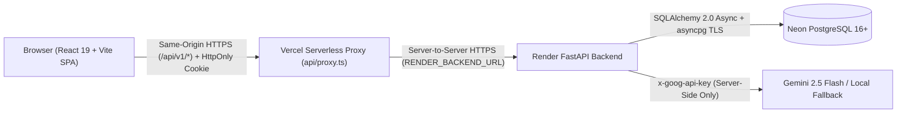

# ASCEND

**AI Nutrition & Fitness Platform** — *"Getting Better Every Day."*


-15803D)


ASCEND is a full-stack nutrition, workout, and biometric tracking platform designed to adapt to distinct fitness objectives. It combines Mifflin-St Jeor energy modeling, Third Normal Form (3NF) food and nutrient tracking, per-set workout telemetry, and goal-aware AI coaching inside one cohesive web application.

---

## Live Demo

`Live Demo: [Coming Soon — Deployment in Progress]`

*(Target deployment: Vercel frontend & API proxy + Render Free FastAPI + Neon Free PostgreSQL. Production deployment URL will be added here after release.)*

---

## Project Overview

Generic calorie trackers often apply one static formula to every user, overwrite historical meal logs when food definitions change, or store sensitive authentication tokens in browser `localStorage`. ASCEND addresses these gaps with:

1. **Pathway-Driven Adaptation:** Tailors dashboards, macro splits, hydration targets, workout templates, and AI guidance across three distinct user pathways.
2. **Relational Data Integrity:** Models food nutrients in Pure 3NF (`nutrients` + `food_nutrients`), preserves `null` for unmeasured micronutrients, and freezes nutrient snapshots on logged meals.
3. **Production-Grade Session Security:** Uses Argon2id password hashing, memory-only JWT access tokens, rotating `HttpOnly` refresh cookies with replay detection, and a same-origin Vercel API proxy.

---

## Three Pathways

| Pathway | Target Focus | Daily Nutrition & Hydration Strategy |
| :--- | :--- | :--- |
| **General Nutrition & Diet** | Sustainable fat loss, maintenance, and everyday habits | Balanced macros, `-420 kcal/day` deficit (for Weight Loss), `36 ml/kg` hydration, meal timeline |
| **Athlete Performance** | Structured training blocks and high-output recovery | `+200 kcal/day` fueling buffer, `2.2 g/kg` protein, carbohydrate timing, `+450 ml` sweat-loss hydration buffer |
| **Weight Gain & Muscle Gain** | Controlled caloric surplus and hypertrophy | `+350 kcal/day` lean surplus, `2.1 g/kg` protein across 4 feeding windows, progressive overload tracking |

---

## Key Features

- **Personalized Nutrition & Goals:** Live Mifflin-St Jeor BMR/TDEE calculation, pace projection, macro percentage breakdown, and customizable calorie/macro/water targets.
- **Food Catalogue & Meal Logging:** Trigram-indexed food search, raw/cooked preparation states, unit-aware portion scaling (`g`, `ml`, `oz`, `cup`, `serving`), side-by-side nutrient comparison, user-private custom foods, and immutable intake snapshots.
- **Hydration Tracking:** One-tap `+250ml`, `+500ml`, `+750ml`, and `-250ml` hydration logging persisted in PostgreSQL.
- **Workout Planning & Set Telemetry:** Pathway workout templates, custom workout plans, user-scoped ad-hoc exercises, live inter-set rest countdown timer, and per-set reps/load (`kg`)/RPE logging.
- **Progress Analytics:** Weight, body fat %, and circumference check-ins with 28-day filtering and interactive Recharts trend curves.
- **AI Coach:** Multi-turn conversational guidance powered by Google Gemini 2.5 Flash (server-side API key) with automatic deterministic local heuristic fallback and explicit non-medical boundaries.
- **Calendar & Reports:** Monthly meal/workout consistency calendar, 7-day rolling adherence summary, and formula-injection-safe CSV export.
- **Secure Authentication & Demo Isolation:** Argon2id auth, rotating `HttpOnly` refresh cookies, password-confirmed pathway switching, and an isolated unauthenticated Demo Mode.

---

## Application Screenshots

> *Production-hosted screenshots will be added after Vercel + Render + Neon deployment.*

- `[Screenshot Placeholder: Editorial Landing Page & Startup Intro]`
- `[Screenshot Placeholder: General Nutrition, Athlete Performance & Muscle Gain Dashboards]`
- `[Screenshot Placeholder: Diet & Meal Logging + Food Comparison]`
- `[Screenshot Placeholder: Workout Runner, Goals & AI Coach]`

---

## Technology Stack

| Layer | Technologies |
| :--- | :--- |
| **Frontend** | React 19, TypeScript, Vite 8, Tailwind CSS 4, Lucide React, Recharts |
| **Backend** | Python 3.13, FastAPI, SQLAlchemy 2.0 Async, `asyncpg`, Pydantic v2, Alembic, Argon2id (`argon2-cffi`), PyJWT |
| **Database** | PostgreSQL 16+ (16 relational tables + `v_food_items_with_nutrients`, `pg_trgm` extension) |
| **AI Integration** | Google Gemini 2.5 Flash (`generativelanguage.googleapis.com` via `httpx`) + deterministic local heuristic fallback |
| **Deployment Target** | Vercel (Frontend + `/api/*` serverless proxy), Render Free (FastAPI), Neon Free (Serverless PostgreSQL) |

---

## Architecture Overview



---

## Database Overview

ASCEND uses a **16-table normalized PostgreSQL schema** across five domains:
- **Identity & Profiles:** `users`, `user_refresh_sessions`, `user_profiles`, `nutrition_goals`
- **Nutrition (Pure 3NF):** `nutrients`, `food_items`, `food_nutrients`, `intake_records` (frozen snapshots), `water_intake_records`
- **Workouts:** `workout_plans`, `exercise_items`, `workout_sessions`, `exercise_set_logs`
- **Biometrics:** `progress_records`
- **AI Coach:** `chat_conversations`, `chat_messages`

See [docs/DATABASE_AND_API.md](./docs/DATABASE_AND_API.md) and [docs/architecture/ER_DIAGRAM.md](./docs/architecture/ER_DIAGRAM.md) for the full ER diagram and schema details.

---

## Project Structure

```text
Ascend/
├── src/                        # React 19 + TypeScript frontend
│   ├── components/             # Landing, Dashboard, Diet, Workouts, Progress, Goals, Coach, Calendar, Reports, Settings
│   ├── services/               # API clients (src/services/api/*) & nutrition calculation helpers
│   ├── data/                   # Demo baseline & curated sample food database
│   ├── types/                  # Shared TypeScript interfaces & enums
│   └── utils/                  # Date and formatting utilities
├── backend/                    # FastAPI + SQLAlchemy 2.0 Async backend
│   ├── app/                    # Endpoints, services, models, schemas, core config/security
│   ├── alembic/                # Reversible PostgreSQL migrations (head: d4e5f6a7b8c9)
│   ├── tests/                  # Pytest unit & API test suite
│   ├── requirements.txt
│   └── pyproject.toml
├── api/                        # Vercel same-origin serverless API proxy (api/proxy.ts)
├── docs/                       # Consolidated documentation & architecture specs
│   ├── PROJECT_DOCUMENTATION.md
│   ├── ENGINEERING_AND_RELEASE_HISTORY.md
│   ├── DEPLOYMENT_GUIDE.md
│   ├── DATABASE_AND_API.md
│   └── architecture/
├── scripts/                    # E2E integration, security, pathway, and proxy test scripts
├── vercel.json                 # Vercel Vite build & /api/:path* rewrite config
├── render.yaml                 # Render Free backend blueprint
├── vite.config.ts              # Vite build & manual chunk splitting
├── .env.example                # Frontend environment template
└── backend/.env.example        # Backend environment template
```

---

## Local Setup (Windows / PowerShell)

### Prerequisites
- Node.js 20+ (`npm`)
- Python 3.12+ (`pip`)
- PostgreSQL 16+ (local instance or Neon connection URI)

### 1. Frontend Setup
```powershell
npm.cmd install
Copy-Item .env.example .env
```

### 2. Backend & Database Setup
```powershell
cd backend
pip install -r requirements.txt
Copy-Item .env.example .env
# Edit backend/.env with your PostgreSQL credentials or DATABASE_URL
python -m alembic upgrade head
```

### 3. Run Locally (Two Terminals)
```powershell
# Terminal 1 — FastAPI Backend (port 8000)
cd backend
python -m uvicorn app.main:create_application --factory --host 127.0.0.1 --port 8000

# Terminal 2 — Vite Frontend (port 3000)
npm.cmd run dev
```

---

## Environment Variables

Reference templates are provided at [.env.example](./.env.example) and [backend/.env.example](./backend/.env.example). **Never commit real `.env` files, database credentials, JWT secrets, or `GEMINI_API_KEY` values.**

---

## Testing

| Check | Command | Purpose |
| :--- | :--- | :--- |
| TypeScript Check | `npm.cmd run lint` | Runs `tsc --noEmit` across `src/` |
| Production Build | `npm.cmd run build` | Builds optimized Vite bundle (`dist/`) |
| Backend Suite | `cd backend; python -m pytest tests/ -v` | Runs backend unit & API tests (requires test/dev DB) |
| Integration E2E | `npx.cmd tsx scripts/test_batch7_integration.ts` | End-to-end API flow against running backend |
| Security Audit | `npx.cmd tsx scripts/test_batch8_security_audit.ts` | Auth, replay detection & cross-tenant isolation tests |
| Pathway Journeys | `npx.cmd tsx scripts/test_batch8_pathways.ts` | Verifies all three pathways end-to-end |
| Vercel Proxy Suite | `npx.cmd tsx scripts/test_phase6_5_2_vercel_proxy.ts` | Unit + live-HTTP tests for `api/proxy.ts` & `vercel.json` |

---

## Documentation

- [Project Documentation](./docs/PROJECT_DOCUMENTATION.md)
- [Engineering & Release History](./docs/ENGINEERING_AND_RELEASE_HISTORY.md)
- [Deployment Guide (Vercel + Render + Neon)](./docs/DEPLOYMENT_GUIDE.md)
- [Database & API Reference](./docs/DATABASE_AND_API.md)
- [Detailed Architecture Specs](./docs/architecture/ARCHITECTURE.md)

---

## Security & Privacy

- **Password Hashing:** Argon2id (`asyncio.to_thread` offloaded) with dummy-hash timing equalization on unknown emails.
- **Token Architecture:** Short-lived JWT access tokens stored strictly in JS memory; opaque rotating refresh tokens hashed (`SHA-256`) in PostgreSQL and delivered via `HttpOnly; SameSite=Lax` cookies with reuse-detection revocation and `X-Requested-With` CSRF protection.
- **Tenant Isolation:** Every user-owned query scopes by `current_user.id`.
- **AI Privacy:** `GEMINI_API_KEY` stays strictly server-side (`x-goog-api-key` header); prompts exclude emails, passwords, and names.

---

## Future Scope

- Live production deployment & post-deployment browser E2E verification on Vercel + Render + Neon.
- Clean production food & workout template seeding CLI.
- Automated USDA FoodData Central / nutrition dataset importer.
- Wearable activity & step-count synchronization.

---

## Academic Project Information

- **Program:** B.Tech Mathematics & Computing
- **Institution:** National Institute of Technology Warangal
