# ASCEND — Entity-Relationship (ER) Diagram & Relationship Matrix

**Document Version:** 1.0.0  
**Target RDBMS:** PostgreSQL 16+  
**Status:** Approved Architectural Design (Phase 3)  
**Author:** Senior Database Systems Architect & Mathematics/Computing Specialist  

---

## 1. Complete System Entity-Relationship Diagram (Mermaid)

The ASCEND schema comprises exactly **15 relational entities** across five domains:

```mermaid
erDiagram
    USERS ||--|| USER_PROFILES : "1:1 has"
    USERS ||--|| NUTRITION_GOALS : "1:1 defines"
    USERS ||--o{ USER_REFRESH_SESSIONS : "1:N authenticates"
    USERS ||--o{ INTAKE_RECORDS : "1:N logs"
    USERS ||--o{ WORKOUT_SESSIONS : "1:N executes"
    USERS ||--o{ PROGRESS_RECORDS : "1:N tracks"
    USERS ||--o{ CHAT_CONVERSATIONS : "1:N initiates"
    USERS ||--o{ CHAT_MESSAGES : "1:N authors"
    USERS ||--o{ FOOD_ITEMS : "1:N creates (custom)"

    USER_REFRESH_SESSIONS ||--o{ USER_REFRESH_SESSIONS : "1:1 rotates-into"

    FOOD_ITEMS ||--o{ INTAKE_RECORDS : "1:N snapshot-referenced"
    FOOD_ITEMS ||--o{ FOOD_NUTRIENTS : "1:N contains"
    NUTRIENTS ||--o{ FOOD_NUTRIENTS : "1:N categorizes"

    WORKOUT_PLANS ||--o{ EXERCISE_ITEMS : "1:N defines"
    WORKOUT_PLANS ||--o{ WORKOUT_SESSIONS : "1:N instantiates"
    WORKOUT_SESSIONS ||--o{ EXERCISE_SET_LOGS : "1:N records"
    EXERCISE_ITEMS ||--o{ EXERCISE_SET_LOGS : "1:N tracks"

    CHAT_CONVERSATIONS ||--o{ CHAT_MESSAGES : "1:N contains"

    USERS {
        uuid id PK
        varchar email UK
        varchar password_hash
        varchar full_name
        boolean is_active
        boolean is_demo_account
        integer jwt_version
        timestamptz created_at
        timestamptz updated_at
    }

    USER_REFRESH_SESSIONS {
        uuid id PK
        uuid user_id FK
        varchar token_hash UK
        varchar device_info
        varchar ip_address
        timestamptz expires_at
        boolean is_revoked
        uuid replaced_by_token_id FK
        timestamptz created_at
    }

    USER_PROFILES {
        uuid id PK
        uuid user_id FK, UK
        varchar pathway
        varchar archetype
        varchar goal_type
        varchar biological_sex
        varchar unit_system
        numeric current_weight_kg
        numeric target_weight_kg
        numeric height_cm
        integer age
        varchar activity_level
        integer training_days_per_week
        integer target_calorie_adjustment
        numeric protein_g_per_kg
        numeric water_ml_per_kg
        timestamptz updated_at
    }

    NUTRITION_GOALS {
        uuid id PK
        uuid user_id FK, UK
        integer daily_calories
        numeric protein_g
        numeric carbs_g
        numeric fat_g
        integer water_ml
        integer daily_steps
        integer weekly_workout_sessions
        integer weekly_activity_minutes
        timestamptz updated_at
    }

    NUTRIENTS {
        uuid id PK
        varchar code UK
        varchar name
        varchar unit
        varchar category
        integer display_order
    }

    FOOD_ITEMS {
        uuid id PK
        varchar code
        varchar name
        text_array alternate_names
        varchar brand_or_source
        varchar category
        varchar cuisine_region
        varchar preparation_state
        numeric reference_quantity
        varchar reference_unit
        varchar reference_label
        numeric grams_per_serving
        numeric edible_portion_pct
        boolean is_micronutrient_complete
        boolean is_custom_user_food
        uuid created_by_user_id FK
        text data_note
        timestamptz created_at
    }

    FOOD_NUTRIENTS {
        uuid food_id PK, FK
        uuid nutrient_id PK, FK
        numeric amount_per_reference_qty
        varchar derivation_code
    }

    INTAKE_RECORDS {
        uuid id PK
        uuid user_id FK
        uuid food_id FK
        varchar food_name
        varchar category
        varchar meal
        date date_logged
        varchar time_logged
        numeric quantity
        varchar unit
        integer computed_calories
        numeric computed_protein_g
        numeric computed_carbs_g
        numeric computed_fat_g
        numeric computed_fiber_g
        numeric computed_sodium_mg
        boolean is_user_logged
        timestamptz created_at
    }

    WORKOUT_PLANS {
        uuid id PK
        varchar title
        varchar day_label
        varchar focus_area
        integer estimated_minutes
        varchar intensity_label
        integer target_calories_burned
        varchar recommended_pathway
        boolean is_system_template
        timestamptz created_at
    }

    EXERCISE_ITEMS {
        uuid id PK
        uuid workout_plan_id FK
        varchar name
        varchar muscle_group
        integer default_sets
        varchar default_reps
        numeric default_load_kg
        integer rest_seconds
        text notes
        integer sort_order
    }

    WORKOUT_SESSIONS {
        uuid id PK
        uuid user_id FK
        uuid workout_plan_id FK
        varchar session_title
        date date_logged
        integer duration_minutes
        integer calories_burned
        integer rpe
        text notes
        boolean completed
        timestamptz created_at
    }

    EXERCISE_SET_LOGS {
        uuid id PK
        uuid workout_session_id FK
        uuid exercise_item_id FK
        varchar exercise_name
        integer set_number
        varchar target_reps
        numeric target_load_kg
        integer actual_reps
        numeric actual_load_kg
        boolean completed
        timestamptz created_at
    }

    PROGRESS_RECORDS {
        uuid id PK
        uuid user_id FK
        date date_logged
        varchar label
        numeric weight_kg
        numeric body_fat_pct
        numeric lean_mass_kg
        numeric waist_cm
        numeric chest_cm
        numeric arm_cm
        numeric thigh_cm
        integer calories_consumed
        numeric protein_consumed_g
        numeric carbs_consumed_g
        numeric fat_consumed_g
        boolean workout_completed
        integer activity_minutes
        integer steps_count
        timestamptz created_at
    }

    CHAT_CONVERSATIONS {
        uuid id PK
        uuid user_id FK
        varchar title
        timestamptz created_at
        timestamptz updated_at
    }

    CHAT_MESSAGES {
        uuid id PK
        uuid conversation_id FK
        uuid user_id FK
        varchar role
        text content
        jsonb structured_insight
        boolean is_mock_response
        timestamptz created_at
    }
```

---

## 2. Comprehensive Relationship Matrix

| Parent Entity | Child Entity | Cardinality | Foreign Key Column | Target Primary Key | Referential Action (ON DELETE) | Business Rationale |
| :--- | :--- | :---: | :--- | :--- | :--- | :--- |
| `users` | `user_profiles` | $1:1$ | `user_id` | `users(id)` | `CASCADE` | A user has exactly one active biometric profile. Deleting a user must purge all private biometric records. |
| `users` | `nutrition_goals` | $1:1$ | `user_id` | `users(id)` | `CASCADE` | A user has exactly one active nutritional target definition. Deleting a user purges their goals. |
| `users` | `user_refresh_sessions` | $1:N$ | `user_id` | `users(id)` | `CASCADE` | A user maintains multiple persistent authentication sessions (devices). Deleting a user purges all active refresh tokens. |
| `user_refresh_sessions` | `user_refresh_sessions` | $1:1$ (Opt) | `replaced_by_token_id` | `user_refresh_sessions(id)` | `SET NULL` | Rotation lineage: links an expired/rotated refresh token to its successor for reuse detection. |
| `users` | `intake_records` | $1:N$ | `user_id` | `users(id)` | `CASCADE` | A user logs zero, one, or many meal items over time. Deleting a user deletes their intake history. |
| `users` | `workout_sessions` | $1:N$ | `user_id` | `users(id)` | `CASCADE` | A user executes multiple training sessions. |
| `users` | `progress_records` | $1:N$ | `user_id` | `users(id)` | `CASCADE` | A user logs daily/weekly biometric checkpoints. |
| `users` | `chat_conversations`| $1:N$ | `user_id` | `users(id)` | `CASCADE` | A user can have multiple coaching dialogue threads. |
| `users` | `chat_messages` | $1:N$ | `user_id` | `users(id)` | `CASCADE` | Messages are owned by the user context. |
| `users` | `food_items` | $1:N$ (Opt) | `created_by_user_id` | `users(id)` | `SET NULL` | A user can author custom food entries. If the user account is closed, the food definition can be anonymized or retained. |
| `food_items` | `food_nutrients` | $1:N$ | `food_id` | `food_items(id)` | `CASCADE` | Composition values belong strictly to the food item. |
| `nutrients` | `food_nutrients` | $1:N$ | `nutrient_id` | `nutrients(id)` | `CASCADE` | Master nutrient definitions link to measured amounts in foods. |
| `food_items` | `intake_records` | $1:N$ (Opt) | `food_id` | `food_items(id)` | `SET NULL` | Intake records maintain an immutable snapshot. If a custom food is deleted, past meal logs remain intact (`SET NULL`). |
| `workout_plans`| `exercise_items` | $1:N$ | `workout_plan_id`| `workout_plans(id)`| `CASCADE` | Exercises belong directly to a structured workout routine. |
| `workout_plans`| `workout_sessions`| $1:N$ (Opt)| `workout_plan_id`| `workout_plans(id)`| `SET NULL` | A session may instantiate a template. If template is modified or deleted, historical execution logs persist. |
| `workout_sessions`| `exercise_set_logs` | $1:N$ | `workout_session_id` | `workout_sessions(id)` | `CASCADE` | Set logs record live reps/load for a specific session instance. Deleting the session cascades to set logs. |
| `exercise_items`| `exercise_set_logs` | $1:N$ (Opt)| `exercise_item_id` | `exercise_items(id)` | `SET NULL` | If an exercise item template is renamed or removed, the historical set execution row preserves the exercise name. |
| `chat_conversations`| `chat_messages` | $1:N$ | `conversation_id`| `chat_conversations(id)` | `CASCADE` | Deleting a conversation thread purges its child message turns. |

---

## 3. Cardinality Validation Against Business Rules

1. **One-to-One Strictness on User Profile and Goals:**
   Enforced via `UNIQUE` constraints on `user_profiles(user_id)` and `nutrition_goals(user_id)`. Prevents profile branching or ambiguous active goals.
2. **Associative Many-to-Many on Food & Nutrients:**
   A food item contains many chemical nutrients; a single nutrient (e.g., Protein, Iron) is present across thousands of foods. The bridge table `food_nutrients` establishes a clean $M:N$ mapping with composite primary key `(food_id, nutrient_id)`.
3. **Decoupled Snapshot Integrity on Historical Logs:**
   Both `intake_records` and `exercise_set_logs` use optional foreign keys with `ON DELETE SET NULL` combined with mandatory denormalized snapshot columns (`food_name`, `exercise_name`, `computed_calories`, `computed_protein_g`). This guarantees historical records survive template edits or custom food deletions without data loss.
