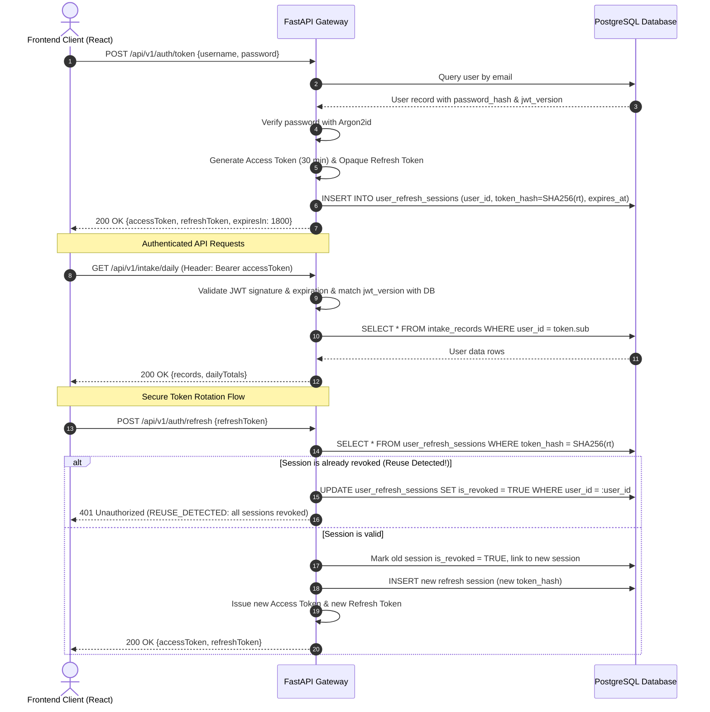

# ASCEND — Security Architecture & Data Protection Specification

**Document Version:** 1.0.0  
**Target Environment:** FastAPI | PostgreSQL 16+  
**Status:** Approved Architectural Design (Phase 3)  
**Author:** Senior Security Architect & Backend Systems Specialist  

---

## 1. Threat Model & Security Objectives

ASCEND stores personal biometric data (weight, height, age, biological sex, circumference measurements), daily nutritional consumption logs, physical training records, and personal conversational coach dialogues. 

### Core Security Objectives

1. **Confidentiality:** Strict cryptographic protection of stored credentials and tokens; zero unauthorized cross-tenant data access.
2. **Integrity:** Guaranteed tamper-proof historical biometrics and intake records; cryptographically signed JWT tokens.
3. **Availability:** Rate-limiting against credential stuffing, brute force, and denial-of-service (DoS) on compute-intensive endpoints (AI coaching, food trigram search).
4. **Least Privilege:** Authorization checks enforced at the database query level; users can only read and mutate records where `user_id == authenticated_user_id`.

---

## 2. Authentication & Credential Security

### 2.1 Password Hashing with Argon2id

Passwords must never be stored in plaintext or with outdated hashing algorithms (MD5, SHA-1, SHA-256, or plain bcrypt). ASCEND uses **Argon2id** (the hybrid version of Argon2 configured with resistance against both side-channel and GPU-assisted attacks) via `argon2-cffi`.

#### Cryptographic Parameters

```python
from argon2 import PasswordHasher

ph = PasswordHasher(
    time_cost=3,        # 3 iterations
    memory_cost=65536,  # 64 MiB RAM usage
    parallelism=4,      # 4 concurrent threads
    hash_len=32,        # 256-bit output hash
    salt_len=16         # 128-bit cryptographically secure random salt
)
```

- **Salt Generation:** Unique, cryptographically secure pseudo-random 16-byte salt per password generated automatically by the CSPRNG (`os.urandom`).
- **Timing Attack Mitigation:** Password verification executes with constant-time equality checks (`hmac.compare_digest`), preventing timing discrepancy attacks during credential evaluation.

### 2.2 JWT Token Lifecycle & Rotation Strategy

ASCEND implements an industry-standard dual-token authentication flow backed by persistent database refresh session tracking:



#### Token Characteristics

| Property | Access Token | Refresh Token |
| :--- | :--- | :--- |
| **Type** | Signed Stateless JWT | Opaque Cryptographic Secret (256-bit entropy) |
| **Algorithm / Format** | HMAC-SHA256 (`HS256`) | Cryptographically secure random string (`secrets.token_urlsafe(32)`) |
| **Payload Claims** | `sub` (user_id), `jwt_version`, `exp`, `iat`, `type: "access"` | Plaintext never stored in DB. Database stores `SHA-256(refresh_token)` |
| **Lifespan** | **30 Minutes** | **7 Days** (or 30 days with Remember Me) |
| **Storage (Frontend)** | In-memory React state (or secure storage) | HTTP-only Secure Cookie or encrypted local storage |
| **Database Tracking** | Validated via `users.jwt_version` in DB | Tracked in `user_refresh_sessions` table with lineage links |

### 2.3 Persistent Refresh-Session Storage, Rotation & Reuse Detection

#### 1. Persistent Storage with Token Hashing
- Plaintext refresh tokens are never written to disk or database tables.
- The server computes a cryptographic digest `token_hash = SHA-256(raw_refresh_token)` and persists it in `user_refresh_sessions` along with client telemetry (`device_info`, `ip_address`, `expires_at`, `created_at`).
- Storing only hashes guarantees that even in the catastrophic event of a database snapshot breach, attackers cannot use the database contents to impersonate users.

#### 2. Strict Token Rotation & Reuse Detection
- **Rotation on Every Use:** When a client exchanges a refresh token at `/api/v1/auth/refresh`, the presented token is immediately invalidated (`is_revoked = TRUE`), and a newly generated refresh token is issued.
- **Lineage Tracking:** The invalidated session records the ID of the new session in `replaced_by_token_id`.
- **Automatic Reuse Attack Mitigation:**
  If an attacker intercepts a refresh token and uses it *after* the legitimate client has already rotated it, the server will look up the `token_hash` and observe `is_revoked == TRUE`.
  Because legitimate clients discard rotated tokens immediately, the presentation of a revoked token is a definitive indicator of token theft or replay attack.
  **Enforcement:** The server instantly revokes **all** active refresh sessions for that entire user (`UPDATE user_refresh_sessions SET is_revoked = TRUE WHERE user_id = :user_id`), increments `users.jwt_version`, and returns `401 Unauthorized (REUSE_DETECTED)`. The legitimate user is prompted to re-authenticate with their credentials, completely severing the attacker's unauthorized access.

### 2.4 Logout, Session Management & `jwt_version` Interaction

ASCEND implements a dual-layer revocation model providing both fine-grained device session management and an instant global kill-switch:

1. **Single-Device Logout (`POST /api/v1/auth/logout`):**
   - The presented refresh token's hash is marked `is_revoked = TRUE` in `user_refresh_sessions`.
   - The user's other active sessions (e.g., mobile phone, work laptop) remain unaffected and valid.
2. **List Active Sessions (`GET /api/v1/auth/sessions`):**
   - Allows users to view all devices currently logged into their account (`device_info`, `ip_address`, `created_at`, `expires_at`).
3. **Revoke Specific Remote Session (`DELETE /api/v1/auth/sessions/{session_id}`):**
   - Marks that specific device's session `is_revoked = TRUE`, preventing further token refreshes on that remote device.
4. **Master Epoch Invalidation via `jwt_version` (Password Change / Security Breach):**
   - When a user changes their password, resets credentials, or selects **"Log out of all devices"**, the server atomically increments `users.jwt_version = users.jwt_version + 1` AND executes `UPDATE user_refresh_sessions SET is_revoked = TRUE WHERE user_id = :user_id`.
   - **Interaction:**
     - Short-lived Access Tokens (which contain the previous `jwt_version` claim) fail authorization in `get_current_user` on their very next request, terminating active sessions in $< 1\text{ second}$ without waiting for the 30-minute expiration.
     - Refresh Tokens fail lookup because all sessions are marked `is_revoked = TRUE`.
     - This provides instantaneous, global invalidation across all devices without needing an external Redis blocklist.

---

## 3. Authorization & Row-Level Data Ownership Enforcement

The application enforces **Multi-Tenant Row-Level Isolation**:
Every domain record (`user_profiles`, `nutrition_goals`, `intake_records`, `workout_sessions`, `exercise_set_logs`, `progress_records`, `chat_conversations`, `chat_messages`) possesses an immutable `user_id` foreign key referencing `users(id)`.
For custom foods (`food_items`), isolation is enforced via `created_by_user_id`: users can search and view all system foods (`is_custom_user_food = FALSE`) plus their own custom foods (`created_by_user_id = current_user.id`), but can never view, update, or delete another user's private custom foods.

### Enforcement Pattern in FastAPI Dependencies & Services

```python
# app/api/v1/deps.py
async def get_current_user(
    token: Annotated[str, Depends(oauth2_scheme)],
    db: Annotated[AsyncSession, Depends(get_db)]
) -> User:
    try:
        payload = jwt.decode(token, settings.SECRET_KEY, algorithms=[settings.ALGORITHM])
        user_id: str = payload.get("sub")
        token_version: int = payload.get("jwt_version")
        if user_id is None or token_version is None:
            raise HTTPException(status_code=401, detail="Invalid token claims.")
    except JWTError:
        raise HTTPException(status_code=401, detail="Token verification failed.")
    
    user = await db.get(User, UUID(user_id))
    if not user or not user.is_active:
        raise HTTPException(status_code=401, detail="User not found or inactive.")
    
    # Revocation check: reject tokens issued before a logout or password change
    if user.jwt_version != token_version:
        raise HTTPException(status_code=401, detail="Token has been revoked. Please log in again.")
        
    return user
```

### Row-Level Ownership Check in Endpoint / Service

When fetching or modifying an entity by ID (e.g., `DELETE /api/v1/intake/records/{record_id}`):

```python
# Service query always binds user_id predicate:
stmt = select(IntakeRecord).where(
    IntakeRecord.id == record_id,
    IntakeRecord.user_id == current_user.id  # Guarantees user can never touch another user's row
)
result = await db.execute(stmt)
record = result.scalar_one_or_none()

if record is None:
    # 404 is intentionally returned rather than 403 to prevent enumeration attacks
    raise EntityNotFoundException("Intake record not found.")
```

---

## 4. Input Sanitization & Injection Defenses

### 4.1 SQL Injection Defense

- **100% Parameterized Queries:** All database interactions are executed strictly through SQLAlchemy 2.0 select/insert/update expressions.
- **Zero Raw String Interpolation:** SQL statements are never constructed via string formatting (`f"SELECT ... WHERE id = '{id}'"`).
- **Type Coercion:** All IDs are parsed as typed `uuid.UUID` objects before database dispatch, preventing SQL payload injection via URI path parameters.

### 4.2 Cross-Site Scripting (XSS) & Content Injection

- Pydantic models strip leading/trailing whitespace and enforce maximum character lengths (`name: str = Field(max_length=200)`).
- HTML tags in text inputs (e.g., meal notes, workout notes, chat prompts) are treated as literal text and escaped during JSON serialization.

---

## 5. Cross-Origin Resource Sharing (CORS) Architecture

CORS is strictly configured in `app/main.py` using FastAPI's `CORSMiddleware`:

```python
app.add_middleware(
    CORSMiddleware,
    allow_origins=[
        "http://localhost:3000",
        "http://127.0.0.1:3000",
    ],
    allow_credentials=True,
    allow_methods=["GET", "POST", "PUT", "PATCH", "DELETE", "OPTIONS"],
    allow_headers=["Authorization", "Content-Type", "Accept"],
    max_age=600,  # Cache pre-flight response for 10 minutes
)
```

- Wildcard origins (`"*"`) with `allow_credentials=True` are strictly prohibited.
- Requests originating from unauthorized domains are blocked at the HTTP pre-flight (`OPTIONS`) boundary by the browser.

---

## 6. Rate Limiting & Denial-of-Service (DoS) Mitigations

To protect CPU-intensive operations and prevent abuse:

1. **Authentication Endpoints (`/api/v1/auth/token`, `/api/v1/auth/register`):**
   - Rate limit: **5 requests per minute per IP address**.
   - Defends against credential stuffing and password guessing.
2. **AI Coach Endpoints (`/api/v1/ai/chat`):**
   - Rate limit: **10 requests per minute per user**.
   - Defends against external Gemini API quota exhaustion.
3. **Food Search Endpoints (`/api/v1/foods/search`):**
   - Rate limit: **60 requests per minute per IP**.
   - Minimum query length: **2 characters** (prevents full-table unindexed scans on 1-character queries).

---

## 7. Secrets Management & Environment Configuration

1. **Zero Secret Check-Ins:** The repository `.gitignore` strictly bans `.env*` files except for `.env.example`.
2. **Entropy Requirements:** `SECRET_KEY` must be generated with at least 256 bits of entropy:
   ```bash
   python -c "import secrets; print(secrets.token_urlsafe(32))"
   ```
3. **Frontend Separation:** No backend secrets, API keys, database credentials, or private tokens are ever included in the Vite frontend build or source tree. The frontend only stores the public API base URL (`VITE_API_BASE_URL`).
