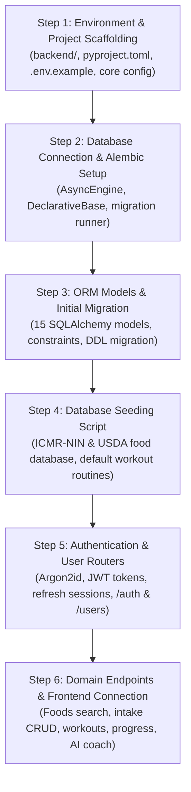

# ASCEND — Phase 3 Architectural Review & Implementation Roadmap

**Document Version:** 1.0.0  
**Status:** Complete Architectural Specification (Phase 3 Complete)  
**Author:** Senior Backend Architect & Database Systems Engineer  
**Date:** November 24, 2026  

---

## 1. Executive Summary & Deliverables Completed

Phase 3 establishes the complete, production-grade architectural blueprint for the ASCEND backend. All seven required architectural specifications have been designed and documented:

1. [`docs/backend/ARCHITECTURE.md`](file:///c:/Users/thiru/OneDrive/Desktop/Projects/Ascend%20Project/docs/backend/ARCHITECTURE.md): Layered architecture, directory layout, module responsibilities, lifespan, dependency injection, and testing strategy.
2. [`docs/backend/DATABASE_DESIGN.md`](file:///c:/Users/thiru/OneDrive/Desktop/Projects/Ascend%20Project/docs/backend/DATABASE_DESIGN.md): PostgreSQL 16 DDL, formal normalization analysis (1NF, 2NF, 3NF), functional dependencies, indexing, and ACID transaction boundaries.
3. [`docs/backend/ER_DIAGRAM.md`](file:///c:/Users/thiru/OneDrive/Desktop/Projects/Ascend%20Project/docs/backend/ER_DIAGRAM.md): Mermaid ER diagram, comprehensive relationship matrix, foreign key cascade actions, and cardinality validations.
4. [`docs/backend/API_SPECIFICATION.md`](file:///c:/Users/thiru/OneDrive/Desktop/Projects/Ascend%20Project/docs/backend/API_SPECIFICATION.md): RESTful contracts under `/api/v1` for Auth, Users, Foods, Intake, Workouts, Progress, and AI Coaching.
5. [`docs/backend/SECURITY_DESIGN.md`](file:///c:/Users/thiru/OneDrive/Desktop/Projects/Ascend%20Project/docs/backend/SECURITY_DESIGN.md): Argon2id password hashing, dual-token JWT rotation, row-level ownership enforcement, CORS policy, rate limiting, and zero-secret frontend isolation.
6. [`docs/backend/FRONTEND_INTEGRATION.md`](file:///c:/Users/thiru/OneDrive/Desktop/Projects/Ascend%20Project/docs/backend/FRONTEND_INTEGRATION.md): TypeScript $\leftrightarrow$ Pydantic mapping, API service binding, migration from prototype storage to HTTP client, error handling without silent fallbacks, and instant demo preservation.
7. [`docs/backend/PHASE_3_REVIEW.md`](file:///c:/Users/thiru/OneDrive/Desktop/Projects/Ascend%20Project/docs/backend/PHASE_3_REVIEW.md): Architectural review, design decisions, resolved trade-offs, and Phase 4 implementation roadmap.

---

## 2. Key Design Decisions & Academic Rigor (DBMS & Mathematics/Computing)

### 2.1 Technology Stack Fidelity

The architecture adheres strictly to the approved, lightweight stack:
- **Language & Runtime:** Python 3.12+ (leveraging modern typing, pattern matching, and performance improvements).
- **Web Framework:** FastAPI (async routing, automatic OpenAPI 3.1 docs, dependency injection).
- **Relational RDBMS:** PostgreSQL 16+ (ACID transactions, trigram GIN indexes, JSONB for coach insights).
- **ORM & Migrations:** SQLAlchemy 2.0 (mapped column typings with `asyncpg`) and Alembic.
- **Validation:** Pydantic v2 (Rust-backed validation, sub-millisecond serialization).
- **Security:** Argon2id (memory-hard password hashing) and PyJWT (HMAC-SHA256).

**Eliminated Bloat:**
- *No Redis:* PostgreSQL connection pooling and sub-millisecond indexed queries eliminate the operational overhead of an external in-memory cache for a single-server deployment.
- *No MongoDB / NoSQL:* All data exhibits clear relational structure, entity integrity, and foreign key relationships.
- *No Microservices:* A clean modular monolith provides maximal maintainability and zero distributed-network latency for this platform.

### 2.2 Pure Third Normal Form Nutrient Architecture (Single Source of Truth)

- **Problem in Prototype / Legacy Handoff:** Storing 10 fixed nutrient columns in `nutrient_values` is relationally rigid, creates 60% NULL sparsity, and requires table migrations to add micronutrients (e.g., Vitamin D, B12, Zinc). Furthermore, duplicating macronutrients on `food_items` violates strict 3NF and introduces the risk of data drift across updates.
- **Pure 3NF Architectural Solution:**
  1. A master `nutrients` catalog defining standard INFOODS chemical codes (`ENERC_KCAL`, `PROCNT`, `FAT`, `CHOCDF`, `FIBTG`, `NA`, etc.).
  2. An associative bridge table `food_nutrients` with composite primary key `(food_id, nutrient_id)`.
  3. **Zero Redundancy on `food_items`:** `food_items` contains strictly food metadata. `food_nutrients` is the **single authoritative source of truth**. All `INSERT`, `UPDATE`, and `DELETE` operations affect only `food_nutrients`, mathematically guaranteeing zero data drift.
  4. For performant client querying, a standard PostgreSQL view `v_food_items_with_nutrients` dynamically aggregates macronutrients per 100g, avoiding premature denormalization without benchmark-driven justification.

### 2.3 Historical Snapshot Integrity in Meal and Workout Logs

- Historical meal logs (`intake_records`) and workout sets (`exercise_set_logs`) store frozen quantitative snapshots (`computed_calories`, `computed_protein_g`, `actual_reps`, `actual_load_kg`) rather than dynamically joining to live catalog items.
- If an admin edits a food formulation or renames an exercise, all past user records remain mathematically intact and historically accurate.

### 2.4 Multi-Pathway Data Preservation & Configurable Targets

- The three pathways (**General Nutrition & Diet**, **Athlete Performance**, and **Weight & Muscle Gain**) share the core data schema.
- Pathway recommendations are treated as **configurable non-medical educational baselines**, not rigid universal clinical prescriptions.
- Users can override caloric adjustments and protein ratios within physiologically safe validation bounds (caloric floor: $1,200\text{ kcal}$ female / $1,500\text{ kcal}$ male; protein: $1.2\text{--}2.5\text{ g/kg}$).
- Switching pathways triggers an atomic update to `user_profiles.pathway` and recalculates `nutrition_goals`. Existing intake records and workout logs are strictly preserved.

### 2.5 Persistent Refresh-Session Storage & Reuse Detection

- Refresh tokens are stored in the database hashed via SHA-256 in `user_refresh_sessions` with device telemetry.
- **Strict Rotation & Lineage:** Every token exchange invalidates the old token and links to the new token via `replaced_by_token_id`.
- **Automatic Reuse Attack Mitigation:** If a previously revoked refresh token is presented, the server immediately revokes all active refresh sessions for that user and increments `jwt_version`, forcing re-authentication and severing unauthorized access.
- **Dual-Layer Revocation:** Normal logout revokes a single device session. Password change or security compromise increments `users.jwt_version`, instantly invalidating all active access tokens and all refresh sessions simultaneously.

---

## 3. Implementation Phasing Roadmap (Phase 4)

When approved to begin backend implementation, work will proceed in six structured, test-driven phases:

1. **Step 1 — Scaffolding & Configuration:**
   - Create `backend/` directory with `pyproject.toml` and dependencies.
   - Configure `app/core/config.py` with Pydantic `BaseSettings`.
2. **Step 2 — Database Engine & Migration Runner:**
   - Set up `app/core/database.py` with `asyncpg` connection pool.
   - Initialize Alembic with `alembic init -t async alembic`.
3. **Step 3 — SQLAlchemy 2.0 Models & Baseline Migration:**
   - Implement all 15 ORM models across all 5 domains with `Mapped[...]` and `mapped_column[...]`.
   - Generate and verify initial Alembic migration (`001_initial_schema.py`).
4. **Step 4 — Reference Seeding Script:**
   - Implement `app/db/seed_data.py` populating standard Indian & Western food items from `mockData.ts` and baseline workout routines for all 3 pathways.
5. **Step 5 — Security & Authentication Endpoints:**
   - Implement `app/core/security.py` (Argon2id + JWT).
   - Implement `/api/v1/auth/register`, `/api/v1/auth/token`, `/api/v1/auth/me`, and user profile endpoints.
6. **Step 6 — Domain Routers & Frontend Integration:**
   - Implement `/api/v1/foods/search` with trigram matching.
   - Implement `/api/v1/intake/records` with server-side portion scaling math.
   - Implement `/api/v1/workouts` (plans, sessions, set logs).
   - Implement `/api/v1/progress` (biometrics, 28-day window filtering).
   - Implement `/api/v1/ai/chat` (context aggregation + Gemini API / heuristic fallback).
   - Configure frontend `VITE_API_BASE_URL` to point to `http://localhost:8000/api/v1`.

---

## 4. Architectural Readiness Sign-Off

The architecture, database design, API specification, security model, and integration plans are fully aligned, mathematically sound, and ready for immediate engineering execution.

**Awaiting approval to begin Phase 4 backend implementation.**
